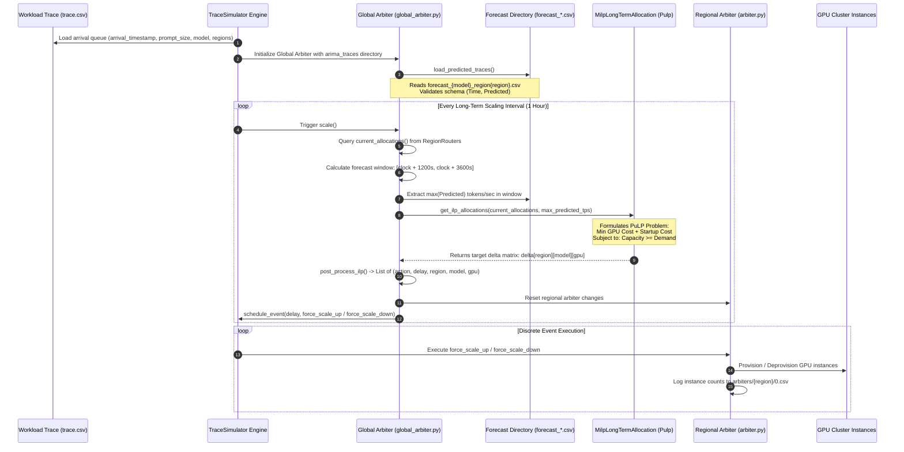
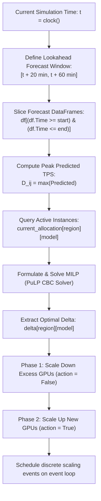
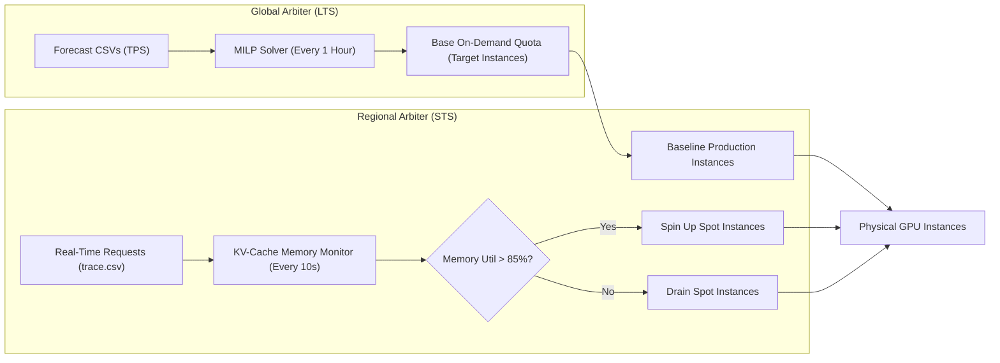

# GPU Allocation in SageServe: Trace Ingestion, Demand Forecasting & MILP Optimization

## 1. Overview and Operational Context

In large-scale distributed Large Language Model (LLM) serving systems, compute resources (such as NVIDIA A100 or H100 GPU instances) are costly and subject to stringent Service Level Agreements (SLAs). Workloads are characterized by:
* Non-stationary, bursty request patterns across multiple geographical regions (e.g., `westus`, `centralus`, `eastus`).
* Diverse model architectures with varying compute-to-memory ratios (e.g., Models `A`, `B`, `C`, `D`).
* Distinct serving phases: **Prefill** (compute-bound, linear scaling with prompt length) and **Decode** (memory-bandwidth bound, sequential token generation).

To serve requests within strict latency budgets (Time-to-First-Token $\text{TTFT} < 1.0\,\text{s}$ for fast interactive workloads) while minimizing idle GPU hours, SageServe employs a **hierarchical autoscaling architecture**:
1. **Long-Term Scaling (LTS) / Global Arbiter**: Solves a global **Mixed-Integer Linear Program (MILP)** periodically (e.g., every 1 hour) over an upcoming forecast window (20 to 60 minutes into the future), rebalancing GPU instances across regions and models.
2. **Short-Term Scaling (STS) / Regional Arbiters**: Runs reactively at fine-grained intervals (every 10 seconds), adjusting spot and on-demand instances based on real-time KV-cache memory pressure.

This document provides a comprehensive technical reference explaining how SageServe ingests its input **Trace CSV** and **Forecasting Directory**, translates them into operational constraints, formulates and solves the MILP problem, and dispatches concrete GPU scale-up and scale-down events to running clusters.

---

## 2. End-to-End Allocation Data Flow

The following sequence diagram illustrates the lifecycle of trace arrivals, time-series forecasting, MILP capacity planning, and instance adjustments inside SageServe.



---

## 3. Input 1: The Workload Trace (`trace.path`)

### 3.1 Trace Schema and Parsing
The input trace (configured via `trace.path` in Hydra) represents historical or simulated real-time request arrivals. In SageServe, the file is parsed by `TraceSimulator.load_trace()`:

```csv
request_id,batch_id,client_tenant,request_type,scenario,sla,utility,regions,model_type,workload_type,application_id,arrival_timestamp,batch_size,prompt_size,token_size
```

* **`arrival_timestamp` (float)**: The simulated arrival time (in seconds from start of simulation).
* **`prompt_size` (int)**: Number of input prompt tokens to be processed during the prefill phase.
* **`token_size` (int)**: Number of output tokens generated during the decode phase.
* **`model_type` (str)**: Target model identifier (`A`, `B`, `C`, `D`).
* **`regions` (str)**: Priority-encoded string of region indices (e.g., `012` means Region 0 is primary, Region 1 is secondary, Region 2 is tertiary).
* **`sla` (int)**: Maximum allowable turnaround or TTFT threshold (e.g., $1\,\text{s}$ for `IW-F`, $60\,\text{s}$ for `IW-N`).

### 3.2 How the Simulator Uses the Trace
1. **Event Scheduling**: `TraceSimulator` enqueues each row in an internal priority queue (`arrival_queue`) sorted by `arrival_timestamp`.
2. **Request Routing**: When `clock() >= arrival_timestamp`, the request is dequeued and submitted to `GlobalRouter`.
3. **Region Selection**: The router checks the priority string (`regions`). If the primary region's cluster has available capacity or manageable queue lengths, the request is dispatched locally; otherwise, it overflows to secondary regions.
4. **Hardware Demand**: The request's `prompt_size` and `token_size` dictate the duration for which prefill and decode GPU workers are locked, directly driving KV-cache memory consumption and triggering reactive scaling if demand outstrips provisioned capacity.

---

## 4. Input 2: The Forecasting Directory (`global_arbiter.arima_traces`)

The proactive global arbiter relies on demand forecasts stored in the directory passed via `global_arbiter.arima_traces`.

### 4.1 File Naming & Required Structure
Within the directory, SageServe requires a discrete CSV file for every valid combination of model and geographic region:
```
<arima_traces>/
├── forecast_A_region0.csv
├── forecast_A_region1.csv
├── forecast_A_region2.csv
├── forecast_B_region0.csv
├── ...
└── forecast_D_region2.csv
```

Each file must strictly contain two numeric columns:
```csv
Time,Predicted
0.0,125000.5
60.0,132000.2
120.0,141500.8
...
```
* **`Time` (float/int)**: Timestamp in simulated seconds (typically bucketed at 60-second intervals).
* **`Predicted` (float)**: Projected aggregate prompt tokens demanded per second (TPS) across that interval.

### 4.2 Forecast Ingestion & Validation (`global_arbiter.py:load_predicted_traces`)
During startup, `MilpGlobalArbiter.load_predicted_traces()` executes strict data validation on every file:
1. **Completeness**: Ensures all models discovered on the region routers have corresponding regional forecast CSVs.
2. **Schema Verification**: Asserts that `{"Time", "Predicted"}` are present, non-empty, and strictly numeric.
3. **Clipping**: Enforces non-negativity:
   $$\text{Predicted} = \max(0, \text{Predicted})$$
4. **Sorting**: Sorts rows monotonically ascending by `Time`.

---

## 5. Computing GPU Allocation: The Long-Term Scaling Algorithm

The global arbiter computes new GPU instance quotas through a multi-step pipeline combining time-window querying and mathematical programming.



### 5.1 Lookahead Horizon Calculation
In `global_arbiter.py:get_ilp_forecast()`, the lookahead window is calculated relative to the current simulation clock $t = \text{clock()}$:
$$\text{forecast\_start} = t + 20 \times 60 = t + 1200\,\text{s}$$
$$\text{forecast\_end} = t + 60 \times 60 = t + 3600\,\text{s}$$

> **Why the 20-minute gap?**
> Provisioning new GPU instances, initializing Docker containers, downloading model weights into GPU VRAM, and warming up the KV cache involves non-trivial initialization latency (interchange time). Querying demand 20 to 60 minutes ahead ensures instances are fully online and warm *before* the peak traffic surge arrives.

For each region $j \in \{0, \dots, R-1\}$ and model $i \in \{0, \dots, M-1\}$, SageServe queries:
$$D_{i,j} = \max_{t' \in [\text{forecast\_start}, \text{forecast\_end}]} \text{Predicted}_{i,j}(t')$$
This conservative peak-demand aggregation guarantees that provisioned capacity can absorb the highest anticipated demand spike during that hour.

---

### 5.2 Mathematical Formulation of the MILP Problem

The core mathematical optimization is implemented in `SageServe-original/long_term_allocation.py` using the **PuLP** linear programming framework.

#### Index Sets
* $i \in \{0, \dots, M-1\}$: Model index ($M$ models).
* $j \in \{0, \dots, R-1\}$: Region index ($R$ regions).
* $k \in \{0, \dots, G-1\}$: GPU hardware type ($G$ GPU types; in default SageServe, $G=1$, representing NVIDIA A100).

#### Model Parameters
* $c_{i,j,k}$: Current active instance count for model $i$ in region $j$ with GPU type $k$.
* $D_{i,j}$: Forecasted peak demand (in tokens per second) for model $i$ in region $j$.
* $\text{TPS}_{i,k}$: Serving throughput capacity (tokens per second) of one GPU instance running model $i$. Configured in `global_arbiter.py`:
  $$\text{Model A} \approx 30 \times 7516.67 = 225,500\,\text{tokens/s}$$
  $$\text{Model B} \approx 30 \times 5398.07 = 161,942\,\text{tokens/s}$$
  $$\text{Model C, D} \approx 30 \times 1,600,000 = 48,000,000\,\text{tokens/s}$$
* $\text{CostGPU}_k$: Running cost per unit time for GPU type $k$ (default $= 10$).
* $\text{StartupCost}_{i,k}$: Model interchange / cold-start penalty (default $= 150\,\text{s}$).
* $M_{\text{big}}$: Big-M constant for logical indicator constraints ($10^6$).

#### Decision Variables
1. $x_{i,j,k} \in \mathbb{Z}$: **Allocation change** (the number of instances to add or remove). Can be positive (scale up) or negative (scale down).
2. $\sigma_{i,j,k} \in \{0, 1\}$: **Increase signal indicator**. Equals $1$ if $x_{i,j,k} > 0$ (scaling up), and $0$ otherwise.
3. $\rho_{i,j,k} \in \{0, 1\}$: **Decrease signal indicator**. Equals $1$ if $x_{i,j,k} \le 0$ (scaling down or no change).
4. $y_{i,j,k} \in \mathbb{Z}_{\ge 0}$: **Effective new allocation cost** (penalizes scale-up cold-start switches).

#### Constraints

1. **Non-Negativity Constraint (Cannot deallocate more instances than currently exist)**:
   $$x_{i,j,k} \ge -c_{i,j,k} \quad \forall i, j, k$$
   Equivalently, the target capacity $c_{i,j,k} + x_{i,j,k} \ge 0$.

2. **Demand Satisfaction Constraint**:
   The aggregate throughput of all active instances must satisfy or exceed the forecasted peak demand:
   $$\sum_{k=0}^{G-1} \left( c_{i,j,k} + x_{i,j,k} \right) \cdot \text{TPS}_{i,k} \ge D_{i,j} \quad \forall i, j$$

3. **Logical Binary Indicators (Big-M Formulation)**:
   $$\sigma_{i,j,k} + \rho_{i,j,k} = 1 \quad \forall i, j, k$$
   $$-M_{\text{big}} \cdot \rho_{i,j,k} + \sigma_{i,j,k} \le x_{i,j,k} \le M_{\text{big}} \cdot \sigma_{i,j,k}$$
   * If $x_{i,j,k} > 0 \implies \sigma_{i,j,k} = 1, \rho_{i,j,k} = 0$.
   * If $x_{i,j,k} \le 0 \implies \sigma_{i,j,k} = 0, \rho_{i,j,k} = 1$.

4. **Startup Penalty Linearization**:
   $$y_{i,j,k} \le \sigma_{i,j,k} \cdot M_{\text{big}}$$
   $$y_{i,j,k} \ge -\sigma_{i,j,k} \cdot M_{\text{big}}$$
   $$y_{i,j,k} \le x_{i,j,k} + (1 - \sigma_{i,j,k}) \cdot M_{\text{big}}$$
   $$y_{i,j,k} \ge x_{i,j,k} - (1 - \sigma_{i,j,k}) \cdot M_{\text{big}}$$
   * When $\sigma_{i,j,k} = 1$ (scale-up): $y_{i,j,k} = x_{i,j,k}$.
   * When $\sigma_{i,j,k} = 0$ (scale-down/neutral): $y_{i,j,k} = 0$.

#### Objective Function
The solver minimizes total operational cost: running GPU rental cost plus the one-time transition startup penalty:
$$\min \sum_{i} \sum_{j} \sum_{k} \left[ x_{i,j,k} \cdot \text{CostGPU}_k + y_{i,j,k} \cdot \text{StartupCost}_{i,k} \right]$$

---

### 5.3 Solving and Post-Processing

The optimization problem is solved using the **COIN-OR CBC Solver** (`PULP_CBC_CMD(msg=0)`). Once solved, the integer solution matrix $\Delta_{j,i,k} = x_{i,j,k}$ is returned.

#### Post-Processing Execution (`post_process_ilp`)
To prevent cluster thrashing or temporary capacity deficits, SageServe splits the actions into two distinct phases:
1. **Scale-Down Phase**: Any negative $\Delta_{j,i,k} < 0$ commands are queued first to free up unused GPU slots.
2. **Scale-Up Phase**: Positive $\Delta_{j,i,k} > 0$ commands are queued to provision target instances.

The arbiter translates each change into discrete events:
```python
if action:  # Scale Up
    f = lambda: region_cluster.arbiter.force_scale_up(model_endpoint)
else:       # Scale Down
    f = lambda: region_cluster.arbiter.force_scale_down(model_endpoint)

schedule_event(delay, f)
```

---

## 6. Interaction Between Global and Regional Arbiters



1. **LTS establishes the baseline floor**: The global arbiter provisions production on-demand instances based on predicted demand 20 to 60 minutes ahead.
2. **STS handles local transients**: The regional arbiter inspects instantaneous memory utilization every 10 seconds. If an unpredicted burst occurs (or before the 20-minute LTS window takes effect), the regional arbiter temporarily spins up short-lived **spot instances** to prevent request drops.
3. **Synchronization**: Whenever the global arbiter fires an hourly LTS update, it invokes `region_cluster.arbiter.reset_changes()`, clearing temporary reactive overrides and synchronizing state with the new global baseline.

---

## 7. Output Artifacts and Logging

When SageServe finishes scaling computations, it exports comprehensive telemetry:

1. **Simulator Execution Log (`run.log`)**:
   Contains the exact input matrices, clock timestamps, and target adjustments:
   ```text
   [root][INFO] - Current allocation at time 3600.0: [[[3], [2], [2], [2]], [[2], [2], [2], [2]], [[4], [2], [2], [2]]]
   [root][INFO] - Building ILP forecast at time 3600.0
   [root][INFO] - Forecast window: 4800.00 -> 7200.00
   [root][INFO] - Max predicted TPS: region=0 model=A prediction=285000.00
   [root][INFO] - Final TPS forecast: [[[285000.0], [140000.0], [90000.0]], ...]
   [root][INFO] - ILP forecast at time 3600.0: [[[1], [0], [0], [0]], [[0], [0], [0], [0]], [[-1], [0], [0], [0]]]
   ```
2. **Arbiter Instance CSVs (`arbiters/{region}/0.csv`)**:
   Records time-series snapshots of active GPU instances per model:
   ```csv
   timestamp,model,prod,spot,memory_util
   3600.0,A,3,31,0.5207
   3600.0,B,2,12,0.5207
   3600.0,C,2,15,0.5207
   3600.0,D,2,13,0.5207
   ```
3. **Pulp Problem LP Dumps (`experiments/ilp_outputs/my_output_at_<time>.lp`)**:
   Full linear programming equations written at each evaluation step, enabling mathematical auditing of decision variables, bounds, and objective weights.

---

## 8. Summary Table: Input Parameters vs. Allocation Decisions

| Input Source | Specific Parameter / Column | Role in GPU Allocation |
| :--- | :--- | :--- |
| **Trace CSV** | `arrival_timestamp` | Controls when requests arrive; drives the event queue. |
| **Trace CSV** | `prompt_size` | Dictates prefill processing time and initial KV-cache allocation. |
| **Trace CSV** | `token_size` | Dictates decode iteration count and KV-cache residency duration. |
| **Trace CSV** | `regions` | Specifies primary and failover region routing preferences. |
| **Forecast CSV** | `Time` | Matched against $[\text{clock} + 20\,\text{m}, \text{clock} + 60\,\text{m}]$ to slice relevant horizon. |
| **Forecast CSV** | `Predicted` | Aggregated via $\max()$ to extract peak anticipated TPS demand ($D_{i,j}$). |
| **Cluster State** | `total_instances` | Ingested as current allocation $c_{i,j,k}$; sets deallocation lower bound $x \ge -c$. |
| **Hardware Config** | `model_tps` | Divides peak TPS demand to calculate required GPU instance count. |
| **Hardware Config** | `model_interchange_time` | Penalty weight for scaling up instances; prevents rapid oscillation. |
| **Regional Arbiter** | `memory_util` | Real-time trigger for spot instance provisioning between LTS cycles. |
