# SageServe MLOps Platform: Comprehensive Technical Architecture & Engineering Reference

## 1. Executive Summary & System Philosophy

### 1.1 The Core Problem in Large Language Model (LLM) Serving
Serving Large Language Models (LLMs) in distributed production environments presents an intricate systems-engineering challenge. LLM inference consists of two fundamentally distinct computational phases with opposing hardware bottlenecks:
1. **Prefill (Prompt Processing)**: Compute-bound, highly parallel matrix multiplications that ingest prompt tokens and populate the Key-Value (KV) cache.
2. **Decode (Token Generation)**: Memory-bandwidth-bound, sequential token generation that repeatedly accesses and appends to the KV cache, producing one token per iteration.

Because user traffic is bursty, non-stationary, and subject to pronounced diurnal cycles, conventional reactive autoscalers—such as Kubernetes Horizontal Pod Autoscaler (HPA) or threshold-based replica managers—fail in production. Reactive mechanisms respond *after* resource utilization spikes have already saturated GPU memory, causing queue buildup, severe SLA violations (violating Time-to-First-Token [TTFT] and Time-Between-Tokens [TBT] thresholds), and widespread request throttling. Conversely, over-provisioning GPUs to absorb peak traffic incurs exorbitant operational costs and under-utilizes costly accelerators (e.g., NVIDIA H100/A100 clusters).

### 1.2 The SageServe Solution
**SageServe** addresses this dilemma through **forecast-aware, disaggregated, multi-region autoscaling**. Rather than scaling reactively, SageServe proactively schedules GPU capacity across multiple geographical regions (e.g., `westus`, `centralus`, `eastus`) and multiple models (e.g., Models `A`, `B`, `C`, `D`) by forecasting incoming token demand ahead of time and solving a global Mixed-Integer Linear Program (MILP / ILP).

### 1.3 The MLOps Imperative
In academic literature, simulators often assume oracle predictions or execute arbitrary, ad-hoc offline forecasts. In production, however, **the demand forecasting model is itself an ML system that requires continuous engineering, validation, versioning, governance, and monitoring**.

The **SageServe MLOps Platform** wraps an enterprise-grade MLOps infrastructure around the workload data and predictive models:
* **The Simulator as Evaluation Bed**: SageServe is treated not as an ML system, but as the downstream operational evaluation environment. The MLOps pipeline manages the lifecycle of the forecasting models and feeds versioned prediction artifacts to the simulator to quantify their impact on operational metrics (SLA violation rates, cost, and instance-hours).
* **Cryptographic Data & Pipeline Provenance**: All traces, cleaned datasets, and forecast artifacts are content-addressed using SHA-256 hashes, tracked in an immutable, append-only lineage ledger (`lineage.jsonl`).
* **Automated Data Quality Assurance**: Every incoming workload trace is verified against formal statistical expectations using **Great Expectations** before being admitted to downstream training or inference.
* **Model Governance & Auditing**: Models (ARIMA, Hidden Markov Models) are packaged into an immutable Model Registry with enforced Model Cards and automated performance qualification gates before promotion to `Production`.
* **Diagnostic Inference & Drift Detection**: Continuous monitoring of serving metrics, latency percentiles (TTFT, TBT), Relative Forecast Workload Scores (RFWS), and input data drift using the Population Stability Index (PSI).
* **Multi-Environment Containerization & CI/CD**: A dual-runtime Docker container (Python 3.12 for modern MLOps, Python 3.11 for the legacy discrete-event simulator) orchestrated via GitHub Actions CI/CD to prevent dependency contamination and guarantee strict reproducibility.

---

## 2. High-Level System Architecture

The following diagram illustrates the complete end-to-end topology of the SageServe MLOps platform, from traffic generation to downstream simulation and observability.

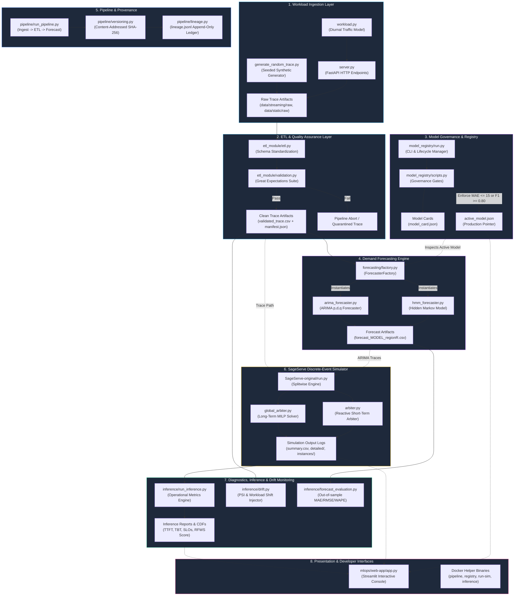

---

## 3. Module-by-Module Technical Deep Dive

The repository is modularly bifurcated into two primary ecosystems: the `mlops/` operational lifecycle framework and the `SageServe-original/` discrete-event simulation engine.

```
Sage-Serve/
├── .github/workflows/pipeline.yml  # Multi-stage CI/CD workflow
├── Dockerfile                      # Multi-venv container definition
├── docker-compose.yml              # Service definitions (Dev workspace + Streamlit UI)
├── docker/                         # Shell environment switchers and CLI binaries
├── mlops/                          # Complete MLOps implementation
│   ├── etl_module/                 # Preprocessing, normalization & Great Expectations
│   ├── forecasting/                # Forecasting abstractions, ARIMA & HMM implementations
│   ├── inference/                  # Metrics extraction, RFWS, drift injection & evaluation
│   ├── model_registry/             # Governance gates, model cards & artifact versioning
│   ├── pipeline/                   # DAG orchestration, content-addressing & lineage ledger
│   ├── tests/                      # Five comprehensive test suites
│   ├── trace_sim/                  # Synthetic workload & streaming FastAPI simulator
│   └── web-app/                    # Streamlit operational console
└── SageServe-original/             # Fork of Splitwise discrete-event simulator + MILP arbiters
```

---

### 3.1 Workload Ingestion & Streaming Simulation (`mlops/trace_sim`)

The trace simulator module synthesizes realistic, production-scale LLM workload traces conforming to the empirical traffic characteristics documented in the SageServe research paper.

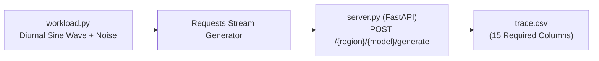

#### Files & Components
* **`workload.py`**:
  * Models traffic arrival processes for three geographic regions (`west`, `central`, `east`) and four model architectures (`A`, `B`, `C`, `D`).
  * Implements three Service Level Agreement (SLA) tiers:
    * **`IW-F` (Interactive-Fast)**: Target TTFT $< 1.0\,\text{s}$, utility weight $3$, daytime peak with 8% weekend floor.
    * **`IW-N` (Interactive-Normal)**: Target TTFT $< 60.0\,\text{s}$, utility weight $2$, ramp-up from Monday to Friday.
    * **`NIW` (Non-Interactive Batch)**: Batch processing with 24-hour turnaround, utility weight $1$, flat profile.
  * Dynamically computes prompt and output token length distributions (modeling bimodal token lengths derived from Azure LLM traces).
* **`server.py`**:
  * Exposes a high-throughput asynchronous FastAPI web application.
  * Implements `POST /{region}/{model}/generate`, accepting `TraceRequest` payloads.
  * Thread-safe serialization: leverages Python's single-threaded async event loop to stream individual requests directly to `trace.csv` without lock contention or row interleaving.
* **`generate_random_trace.py`**:
  * Generates static, reproducible synthetic traces for offline experimentation.
  * Parameterized by `--num-requests` and `--seed`. Because pseudorandom streams are deterministic, identical arguments guarantee byte-identical CSV artifacts, yielding identical SHA-256 hashes.
* **`__main__.py`**:
  * Orchestrates streaming runs (`simulate_streaming()`).
  * Features time compression via `--speedup` (e.g., replaying 1 hour of traffic in 60 wall-clock seconds) and rate scaling (`--rate-scale`).

#### Data Contract (Trace Schema)
Every generated trace strictly adheres to 15 typed columns:
```csv
request_id,batch_id,client_tenant,request_type,scenario,sla,utility,regions,model_type,workload_type,application_id,arrival_timestamp,batch_size,prompt_size,token_size
```
* `regions`: A 3-digit priority string encoding (e.g., `012`, `102`, `201`), indicating primary and failover target regions.
* `workload_type`: `"prod"` for online serving (`batch_id = -1`) or offline batch jobs.

---

### 3.2 ETL & Data Quality Assurance (`mlops/etl_module`)

In accordance with MLOps best practices, raw traces are never fed directly to downstream models. The ETL module guarantees data hygiene, schema conformance, and structural integrity.

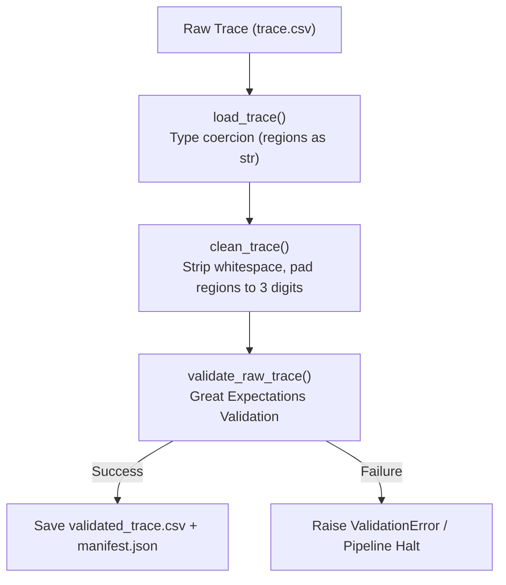

#### Files & Components
* **`validation.py`**:
  * Utilizes **Great Expectations (GX)** with an ephemeral in-memory execution context.
  * Configures an expectation suite (`sageserve_raw_trace`) verifying:
    * Exact column presence and ordering matching `RAW_COLUMNS`.
    * Absence of null values in critical dimensions (`arrival_timestamp`, `prompt_size`, `model_type`, `regions`).
    * Non-negative constraints: `arrival_timestamp >= 0`, `prompt_size >= 0`, `token_size >= 0`.
    * Categorical validity: `model_type` values must belong to `['A', 'B', 'C', 'D']`.
    * Region encoding validity: `regions` must belong to permutations of regions (`012`, `021`, `102`, `120`, `201`, `210`).
* **`etl.py`**:
  * `load_trace(trace_path)`: Reads raw CSVs with explicit string dtypes for `regions` to preserve leading zeroes (e.g., preventing `012` from parsing as integer `12`).
  * `clean_trace(df)`: Trims whitespace, zero-pads region identifiers (`zfill(3)`), drops unparseable rows, and sorts deterministically by `arrival_timestamp`.
  * `run_etl(raw_dir, source)`: Integrates version management. Computes the clean version hash using `derive_id(parents=[raw_version], params=CLEAN_PARAMS)`.
  * If `CLEANING_VERSION` changes, the version hash changes automatically, ensuring full auditability of pipeline logic modifications.

---

### 3.3 Demand Forecasting Engine (`mlops/forecasting`)

The forecasting subsystem provides predictive demand projections consumed by the SageServe MILP long-term capacity planner.

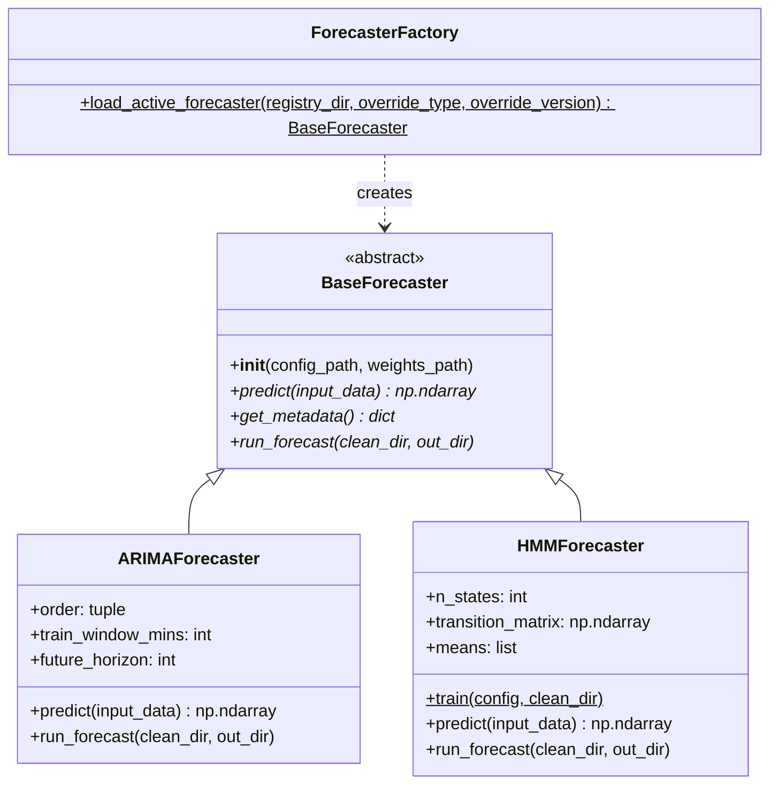

#### Files & Components
* **`base.py`**:
  * Defines `BaseForecaster(ABC)`, enforcing uniform interfaces across all statistical and machine learning models.
  * Every model must implement `predict(input_data)` (generating $H$-step ahead prompt-token predictions) and `get_metadata()`.
* **`trace_io.py`**:
  * Contains `load_clean_trace()` and `aggregate_series()`.
  * Buckets irregular arrival timestamps into discrete 60-second intervals (`bucket_seconds = 60`), summing aggregate `prompt_size` per interval for each unique `(model_type, source_region)` pair.
* **`arima_forecaster.py`**:
  * Implements an AutoRegressive Integrated Moving Average (ARIMA) forecaster using `statsmodels.tsa.arima.model.ARIMA`.
  * Ingests a historical lookback window (e.g., 60 minutes), fits an $\text{ARIMA}(p, d, q)$ model, and produces an out-of-sample forecast for the next horizon (e.g., 60 minutes).
  * Writes standardized CSV files: `forecast_{model}_region{region}.csv` containing `[timestamp, predicted_demand]`.
* **`hmm_forecaster.py`**:
  * Implements a discrete Hidden Markov Model (HMM) forecaster.
  * Captures latent regime shifts in network traffic (e.g., transition from low-traffic background noise to high-traffic midday surge).
  * Features an automated offline training routine (`HMMForecaster.train()`) that estimates state transition probabilities and Gaussian emission means directly from a clean trace.
* **`factory.py`**:
  * Implements the Factory Pattern (`ForecasterFactory.load_active_forecaster()`).
  * Decouples the downstream execution pipeline from concrete model classes. Reads `data/model_registry/active_model.json` to resolve whether ARIMA, HMM, or another model is active, and instantiates the forecaster with registered weights and hyperparameters.

---

### 3.4 Model Registry & Governance Framework (`mlops/model_registry`)

The model registry functions as the authoritative source of truth and governance gatekeeper for predictive models.

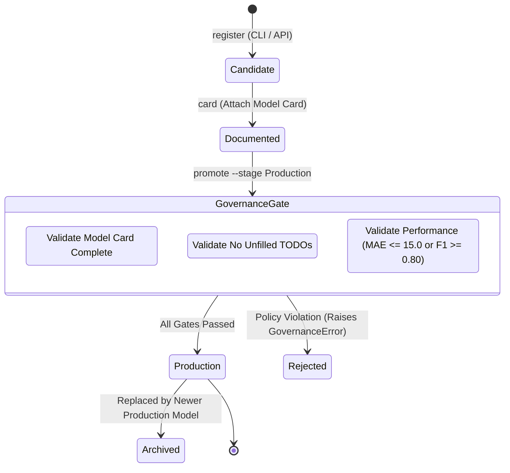

#### Files & Components
* **`scripts.py`**:
  * Core governance logic and directory hierarchy management.
  * Models are stored in `data/model_registry/models/<model_name>/<version>/` containing:
    * `config.yaml`: Model hyperparameters, lookback window, horizon.
    * `manifest.json`: Registration timestamp, cryptographic hashes, author, baseline metrics.
    * `weights.*` (optional): Pre-trained model artifacts (e.g., `transition_matrix.pkl` for HMM).
    * `model_card.json`: Structured documentation describing intended use, training dataset, and limitations.
  * **Automated Governance Gates (`promote_model`)**:
    * **Documentation Check**: Enforces presence of `model_description`, `intended_use`, and `limitations`. Rejects any card containing placeholder `"TODO"` strings.
    * **Performance Gate**: Promoted models must achieve `MAE <= 15.0` (for regression time-series models) or `F1 >= 0.80`. Attempts to promote an inferior model throw `GovernanceError`.
* **`location.py`**:
  * Encapsulates `MODEL_REGISTRY_DIR` resolution, falling back to `<repo_root>/data/model_registry` unless overridden by environment variables.
* **`run.py`**:
  * Command-line interface (CLI) for model engineers:
    ```bash
    python -m model_registry.run register --name arima --config arima.yaml --metrics mae=9.2
    python -m model_registry.run card --name arima --version v1 --description "Production ARIMA" --intended-use "1h load prediction" --limitations "Bursty traffic"
    python -m model_registry.run promote --name arima --version v1 --stage Production
    python -m model_registry.run active
    ```
* **`active_model.json`**:
  * Atomic metadata pointer recording the current production model, version, config path, and weights path.

---

### 3.5 Pipeline Orchestration, Versioning & Lineage (`mlops/pipeline`)

Data pipelines must be deterministic, non-destructive, and fully traceable. The pipeline module provides content-addressed artifact versioning and cryptographic lineage tracking without requiring external heavyweight infrastructure.

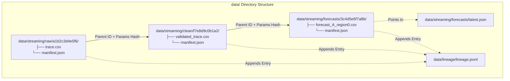

#### Files & Components
* **`versioning.py`**:
  * **Content-Addressed Version IDs**:
    * For raw data: $\text{Version ID} = \text{SHA-256}(\text{file content})[0:12]$.
    * For derived stages (clean, forecast): $\text{Version ID} = \text{SHA-256}(\text{parent\_ids} + \text{parameters})[0:12]$.
  * **Idempotency**: Before executing an expensive ETL or forecasting run, the pipeline verifies whether `data/<source>/<stage>/<version_id>` already exists. If present, execution is skipped and the cached artifact is reused.
  * **Atomic Pointers**: Updates `latest.json` in each stage directory upon successful stage completion.
  * **Manifests**: Every artifact directory contains a `manifest.json` capturing the git commit hash, timestamp, parameters, input dependencies, and output file checksums.
* **`lineage.py`**:
  * Manages `data/lineage/lineage.jsonl`, an append-only JSON Lines ledger.
  * Every pipeline run records the creation of an artifact, its direct parent IDs, and execution metadata.
  * Provides dependency-graph resolution (`ancestors()`) to recursively reconstruct the full lineage tree of any forecast artifact back to its originating raw trace.
* **`run_pipeline.py`**:
  * Unified orchestrator CLI:
    ```bash
    python -m pipeline.run_pipeline --source streaming --duration 600 --speedup 60
    ```
  * Coordinates sequential execution through `ingest -> etl -> forecast`, passing verified artifact paths down the pipeline.

---

### 3.6 The SageServe Discrete-Event Simulator (`SageServe-original`)

The simulation engine is a high-fidelity, discrete-event simulation framework for LLM serving clusters, originally derived from the Splitwise simulator and substantially augmented with multi-region routing and hierarchical autoscaling.

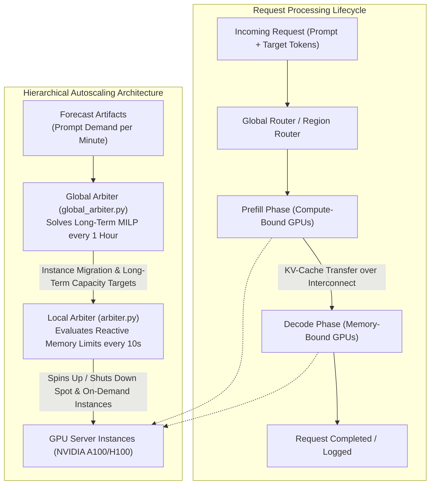

#### Architecture & Key Modules
* **Core Discrete-Event Engine**:
  * `simulator.py`: Manages the global simulation clock and event queue (`schedule_event`).
  * `request.py`, `task.py`, `flow.py`: Decomposes high-level requests into granular GPU tasks (prefill computation, network transfer of KV-cache, decode iterations).
* **Hardware & Performance Models**:
  * `performance_model.py`: Analytical execution latency model based on GPU FLOPS, memory bandwidth, tensor parallelism, and batch sizes.
  * `power_model.py`: Computes dynamic wattage and energy consumption per GPU instance based on compute utilization and idle states.
* **Multi-Region Orchestration**:
  * `region.py`, `region_cluster.py`: Represents distributed regional data centers (`westus`, `centralus`, `eastus`).
  * `global_router.py`, `region_router.py`: Directs requests across regions based on regional capacity, locality, and SLA priority tiers.
* **Hierarchical Autoscaling**:
  * **Short-Term Reactive Arbiter (`arbiter.py`)**: Runs every 10 seconds. Monitors instantaneous KV-cache memory pressure across active GPU instances. If memory utilization exceeds high watermarks (e.g., 85%), it spins up spot or on-demand instances; if under-utilized, it drains and terminates instances.
  * **Long-Term Proactive Arbiter (`global_arbiter.py`, `long_term_allocation.py`)**: Runs on hourly horizons. Consumes the forecasted prompt token demand produced by the MLOps pipeline and solves a Mixed-Integer Linear Program (MILP / ILP). The solver minimizes aggregate instance cost, inter-region network egress, and power penalties while guaranteeing sufficient compute headroom to satisfy SLA deadlines.

---

### 3.7 Inference Diagnostics, Scoring & Drift Analysis (`mlops/inference`)

Once a simulation completes, the inference module performs forensic analysis on the exported simulation telemetry to evaluate operational success.

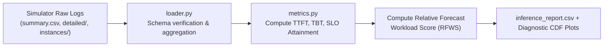

#### Files & Components
* **`loader.py`**:
  * Loads and parses simulation run directories (`experiments/results/*`).
  * Validates completeness across `summary.csv`, windowed latency distributions in `detailed/*.csv`, and time-series resource traces in `instances/*.csv`.
* **`metrics.py`**:
  * Extracts Service Level Objectives (SLOs):
    * **TTFT Violations**: Percentage of requests where Time-to-First-Token exceeds threshold (default $10.0\,\text{s}$).
    * **TBT Violations**: Percentage of requests where Time-Between-Tokens exceeds threshold (default $0.20\,\text{s}$).
  * **Relative Forecast Workload Score (RFWS)**:
    * Implements a normalized, multi-criteria benchmark score comparing multiple autoscaling and forecasting configurations within a shared cohort:
      $$\text{RFWS} = w_{\text{slo}} S_{\text{slo}} + w_{\text{stability}} S_{\text{stability}} + w_{\text{demand}} S_{\text{demand}} + w_{\text{cost}} S_{\text{cost}} + w_{\text{throughput}} S_{\text{throughput}}$$
    * Weights default to: $\text{SLO} = 0.35$, $\text{Stability} = 0.25$, $\text{Demand} = 0.20$, $\text{Cost} = 0.10$, $\text{Throughput} = 0.10$.
* **`drift.py`**:
  * Executes controlled workload-shift experiments to test autoscaler resilience against non-stationary distribution drift.
  * Injects synthetic drift into historical traces (e.g., multiplying prompt lengths by $2.5\times$ or shifting diurnal arrival peaks).
  * Computes the **Population Stability Index (PSI)** between baseline and shifted workloads:
    $$\text{PSI} = \sum_{i=1}^{k} \left( P_i - Q_i \right) \times \ln\left(\frac{P_i}{Q_i}\right)$$
    * $\text{PSI} < 0.1$: No significant distribution shift.
    * $0.1 \le \text{PSI} < 0.2$: Moderate shift.
    * $\text{PSI} \ge 0.2$: Severe distribution drift requiring model retraining.
* **`forecast_evaluation.py`**:
  * Directly evaluates prediction accuracy against observed trace arrivals across minute buckets:
    * Mean Absolute Error (MAE): $\frac{1}{N}\sum |y_t - \hat{y}_t|$
    * Root Mean Squared Error (RMSE): $\sqrt{\frac{1}{N}\sum (y_t - \hat{y}_t)^2}$
    * Weighted Absolute Percentage Error (WAPE): $\frac{\sum |y_t - \hat{y}_t|}{\sum y_t}$
* **`plots.py` & `matrix_plots.py`**:
  * Generates high-resolution diagnostic visualizations: Cumulative Distribution Functions (CDFs) of TTFT/TBT latencies, instance allocation vs. demand curves, and RFWS cohort comparison heatmaps.

---

### 3.8 Unified Streamlit Web Console (`mlops/web-app`)

The web console provides a modern, interactive dashboard for engineers and operators to control and inspect the entire platform.

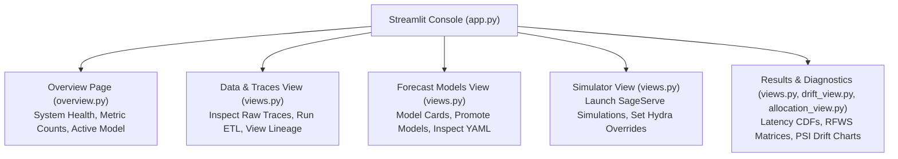

* **`overview.py`**: High-level status board displaying total counts of raw traces, validated datasets, generated forecasts, registered models, and the active production model pointer.
* **`views.py`**:
  * **Traces**: Interactively trigger static trace generation or live FastAPI streaming simulations; view lineage trees.
  * **Models**: Inspect model registry configurations, view model cards, and promote candidate models to Production.
  * **Simulator**: Formulate and trigger SageServe simulation runs with custom Hydra overrides.
  * **Results**: Interactive exploration of latency percentiles, cost breakdowns, and CSV reports.
* **`drift_view.py`**: Dedicated visualization for controlled workload drift studies, showing PSI progression and prompt size distribution divergence.
* **`allocation_view.py`**: Visualizes long-term instance allocation decisions made by the MILP solver against real-time short-term instance adjustments over time.

---

## 4. Git Pipeline for CI/CD

The repository implements a robust, three-stage continuous integration and continuous deployment pipeline hosted on **GitHub Actions** (`.github/workflows/pipeline.yml`).

### 4.1 Trigger Policies & Path Filtering
To avoid unnecessary cloud compute overhead, the pipeline triggers exclusively on `push` and `pull_request` events targeting the `main` or `sreenath/ci-cd` branches when changes affect:
* `mlops/**`
* `SageServe-original/**`
* `.github/workflows/pipeline.yml`

### 4.2 CI/CD Workflow Architecture

```mermaid
sequenceDiagram
    autonumber
    actor Dev as Developer
    participant Git as GitHub Repository
    participant J1 as Job 1: Unit Tests
    participant J2 as Job 2: Integration Tests
    participant J3 as Job 3: Simulator & Inference

    Dev->>Git: git push origin main / PR
    Git->>J1: Trigger Workflow on ubuntu-latest

    rect rgb(30, 41, 59)
        Note over J1: Python 3.12 Virtual Environment
        J1->>J1: Install mlops/requirements.txt
        J1->>J1: Run test_inference.py
        J1->>J1: Run test_etl.py (GX checks)
        J1->>J1: Run test_forecasting.py
        J1->>J1: Run test_model_registry.py (Governance)
        J1->>J1: Run test_pipeline.py (Lineage & Hashes)
    end
    J1-->>Git: Status: Success (Unit Tests Passed)

    Git->>J2: Trigger Integration Tests (needs: unit-tests)
    rect rgb(30, 41, 59)
        Note over J2: Python 3.12 Virtual Environment
        J2->>J2: Register candidate ARIMA model config
        J2->>J2: Generate & attach Model Card
        J2->>J2: Promote model to Production (verify governance gates)
        J2->>J2: Run full pipeline: ingest -> etl -> forecast (streaming, 60s)
        J2->>J2: Verify lineage append-only ledger recorded all steps
    end
    J2-->>Git: Status: Success (Pipeline Verified)

    Git->>J3: Trigger Simulator & Inference (needs: integration-tests)
    rect rgb(30, 41, 59)
        Note over J3: Dual Python Runtime (3.12 MLOps + 3.11 SageServe)
        J3->>J3: (Py3.12) Run streaming pipeline (generate trace & forecasts)
        J3->>J3: (Py3.12) Resolve dynamic artifact paths via versioning API
        J3->>J3: (Py3.11) Execute SageServe simulator (run.py with trace & ARIMA)
        J3->>J3: (Py3.12) Run inference engine on simulation outputs
        J3->>J3: Export streaming_ci.csv report
    end
    J3-->>Git: Status: Success (Full System Validated)
```

### 4.3 Detailed Job Breakdown

#### Job 1: Unit Tests (`unit-tests`)
* **Environment**: `ubuntu-latest`, Python 3.12.
* **Objective**: Fast-failing validation of individual module units.
* **Executes**:
  * `tests.test_inference`: Verifies latency math, TBT calculation, percentile extraction, boundary checks, and RFWS cohort score normalization.
  * `tests.test_etl`: Validates Great Expectations constraints, null handling, type coercion, and schema conformance.
  * `tests.test_forecasting`: Tests forecaster parameter validation, horizon generation, empty inputs, and factory loading.
  * `tests.test_model_registry`: Tests version incrementation, manifest generation, Model Card validation, and governance promotion gates.
  * `tests.test_pipeline`: Tests content hashing (`sha256`), ID derivation, pointer updates, and lineage DAG traversal.

#### Job 2: Integration Tests (`integration-tests`)
* **Environment**: `ubuntu-latest`, Python 3.12.
* **Objective**: Verifies the seamless handoff of data between disparate MLOps modules.
* **Execution Flow**:
  1. Bootstraps a candidate ARIMA configuration YAML (`order: {p: 1, d: 1, q: 1}`).
  2. Registers the model with baseline validation metrics (`mae = 10.0`).
  3. Generates a compliant Model Card satisfying governance prerequisites.
  4. Promotes the model to `Production`, atomically updating `active_model.json`.
  5. Executes the end-to-end MLOps pipeline (`python -m pipeline.run_pipeline --source streaming --duration 60 --speedup 60`).
  6. Inspects `data/lineage/lineage.jsonl` to ensure all stages (raw, clean, forecast) were recorded with correct cryptographic parent pointers.

#### Job 3: SageServe Simulator & Inference (`sageserve-simulator-inference`)
* **Environment**: `ubuntu-latest`, dual Python installation (Python 3.12 and Python 3.11).
* **Objective**: Full end-to-end hardware-in-the-loop smoke test.
* **Execution Flow**:
  1. **MLOps Phase (Python 3.12)**: Generates a 60-second streaming trace, runs Great Expectations ETL, and invokes the active production ARIMA model to generate regional forecast CSVs.
  2. **Dynamic Path Resolution**: Dynamically queries the pipeline versioning API (`pipeline.versioning.resolve_version`) to locate the exact content-addressed directory paths for the trace and forecast artifacts.
  3. **Simulator Execution (Python 3.11)**: Activates the Python 3.11 environment, installs simulator dependencies (including Hydra and PyTorch), and invokes `SageServe-original/run.py`:
     ```bash
     python run.py \
       trace.path="$STREAMING_TRACE" \
       global_arbiter.arima_traces="$STREAMING_FORECAST_DIR" \
       short_term_scaling=True \
       long_term_scaling=True
     ```
  4. **Downstream Inference Analysis (Python 3.12)**: Re-activates the MLOps environment and runs `mlops/inference/run_inference.py` across the simulator output directory to compute TTFT/TBT distributions, verify SLA violations, and write a final diagnostic report (`mlops/inference/reports/streaming_ci.csv`).

---

## 5. Docker Architecture & Containerization Strategy

### 5.1 The Multi-Runtime Challenge
Modern MLOps stacks (e.g., Python 3.12, Great Expectations, modern Pandas, Pydantic v2) require updated Python runtimes. In contrast, the legacy SageServe simulation engine and its underlying PyTorch/Hydra dependency matrix require Python 3.11.

Attempting to resolve all dependencies into a single global Python environment creates unsolvable package conflicts (e.g., conflicting NumPy C-APIs, PyTorch version locks, and Great Expectations dependency constraints).

### 5.2 Multi-Virtualenv Architecture inside Docker
The platform resolves this using a unified multi-virtualenv container architecture built with Astral's ultra-fast package manager, **`uv`**.

```mermaid
flowchart TB
    subgraph HostSystem["Host Operating System"]
        REPO["Repository Root (/workspace)"]
        PORT["Port 8501 (Streamlit UI)"]
    end

    subgraph Container["Docker Container: sageserve-dev (FROM python:3.12-slim)"]
        UV["uv Binary (ghcr.io/astral-sh/uv:0.8.0)"]
        
        subgraph Venvs["Isolated Virtual Environments (/opt/venvs/)"]
            V1["/opt/venvs/mlops (Python 3.12)<br/>pandas, great_expectations, statsmodels,<br/>fastapi, uvicorn, pydantic"]
            V2["/opt/venvs/sim (Python 3.11)<br/>torch, hydra-core, pulp,<br/>SageServe discrete-event engine"]
            V3["/opt/venvs/app (Python 3.12)<br/>streamlit, altair, pyyaml"]
        end

        subgraph Tooling["CLI Tooling & Shell Integration (/workspace/docker/)"]
            SH["sageserve.sh (Shell Aliases & Switchers)<br/>Functions: mlops, sim, root"]
            BIN["docker/bin/ Executables<br/>pipeline, registry, run-sim, latest, inference"]
        end
    end

    REPO -->|Mounted Volume (-v .:/workspace)| Container
    Container -->|Exposed Port| PORT
    UV -->|Constructs| V1
    UV -->|Constructs| V2
    UV -->|Constructs| V3
    SH -->|Switches Path & Active Venv| Venvs
    BIN -->|Directs Execution to Specific Venv| Venvs
```

### 5.3 Dockerfile Implementation Details
The `Dockerfile` defines an optimized, multi-stage, multi-runtime environment:
1. **Base Layer**: `python:3.12-slim` with `git` and `build-essential` installed. Git configuration marks `/workspace` as a safe directory to preserve git commit tracking in manifests.
2. **`uv` Integration**: Copies the pre-compiled `uv` binary from `ghcr.io/astral-sh/uv:0.8.0`.
3. **Environment 1 (`/opt/venvs/mlops`)**: Provisioned with Python 3.12, hosting dependencies from `mlops/requirements.txt`.
4. **Environment 2 (`/opt/venvs/sim`)**: Provisioned with Python 3.11 (downloaded and managed on-the-fly by `uv`), hosting simulation dependencies from `SageServe-original/requirements.txt`.
5. **Environment 3 (`/opt/venvs/app`)**: Provisioned with Python 3.12, hosting Streamlit and visual analytics libraries.
6. **Shell Ergonomics**: Injects `docker/sageserve.sh` into `/etc/bash.bashrc`, exposing interactive switcher commands (`mlops`, `sim`, `root`) and putting `/workspace/docker/bin` on the system `$PATH`.

### 5.4 Docker Helper Executables (`docker/bin/`)
To eliminate manual activation of virtual environments, dedicated executable wrappers route commands to their corresponding interpreters:
* **`docker/bin/pipeline`**: Calls `/opt/venvs/mlops/bin/python -m pipeline.run_pipeline "$@"`.
* **`docker/bin/registry`**: Calls `/opt/venvs/mlops/bin/python -m model_registry.run "$@"`.
* **`docker/bin/latest`**: Resolves the latest version directory for any source and stage (`latest streaming forecasts`).
* **`docker/bin/run-sim`**: Automatically retrieves the latest raw trace and corresponding forecast directory using `latest`, verifies file existence, switches to `/workspace/SageServe-original`, and launches the simulator using `/opt/venvs/sim/bin/python`.
* **`docker/bin/inference`**: Invokes the diagnostic evaluation engine using `/opt/venvs/mlops/bin/python`.

### 5.5 Docker Compose Orchestration (`docker-compose.yml`)
The composition coordinates two concurrent services:
1. **`sageserve`**: An interactive developer shell service mounting the local repository to `/workspace`, enabling real-time code modifications without rebuilding the container.
2. **`webui`**: A persistent service running the Streamlit dashboard (`/opt/venvs/app/bin/streamlit run app.py`), bound to `0.0.0.0:8501` and port-forwarded to `8501` on the host machine.

---

## 6. End-to-End Operational Lifecycle

The diagram below details the operational progression executed across the platform during a complete model iteration and evaluation cycle.

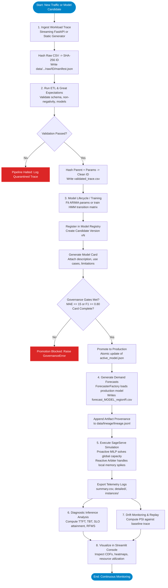

---

## 7. Comparative Summary of Key Platform Capabilities

| Dimension | Legacy / Ad-Hoc Simulation Approaches | SageServe MLOps Platform |
| :--- | :--- | :--- |
| **Forecasting Model Lifecycle** | Hardcoded, static forecast files generated by unversioned notebook scripts | Unified abstract interface (`BaseForecaster`), dynamic instantiation via `ForecasterFactory`, supporting multiple model paradigms (ARIMA, HMM) |
| **Data Quality Assurance** | Manual inspection; errors cause unhandled crashes inside the simulator | Automated schema, type, and range validation via **Great Expectations** prior to downstream admission |
| **Artifact Versioning** | Ad-hoc file naming (e.g., `trace_v2_final.csv`) | Immutable, content-addressed version IDs derived from SHA-256 content and parameter hashing |
| **Auditability & Provenance** | No record of which forecast produced which simulation run | Cryptographic append-only lineage ledger (`lineage.jsonl`) recording full ancestor DAG trees |
| **Model Governance** | Direct modification of active model weights without verification | Enforced Model Cards and automated performance qualification gates (`MAE <= 15.0`) before `Production` promotion |
| **Operational Evaluation** | Abstract statistical error only (e.g., test MAE) | Operational system-level metrics: TTFT/TBT latency CDFs, SLA attainment, instance-hours, and Relative Forecast Workload Score (RFWS) |
| **Drift Monitoring** | Blind to data distribution changes over time | Population Stability Index (PSI) calculation and controlled workload-shift replay experimentation |
| **Runtime Environment** | Fragile local Python setup prone to dependency breakage | Isolated dual-environment Docker container (Python 3.12 MLOps + Python 3.11 Simulator) managed via `uv` |
| **CI/CD Automation** | Manual execution of scripts | Multi-stage GitHub Actions CI/CD executing unit tests, integration pipeline, simulator smoke test, and inference scoring |

---

## 8. Summary & Verification Commands

To verify and operate the entire system locally or within the Docker container:

```bash
# 1. Enter the Docker development environment
docker compose run --rm sageserve

# 2. Run all unit tests across all 5 MLOps modules
python -m unittest discover -s mlops/tests -v

# 3. Register and promote a production ARIMA model
python -m model_registry.run register --name arima --config mlops/tests/test_arima.yaml --metrics mae=8.5
python -m model_registry.run card --name arima --version v1 --description "Prod ARIMA" --intended-use "Serving" --limitations "Bursty traffic"
python -m model_registry.run promote --name arima --version v1 --stage Production

# 4. Execute the complete streaming pipeline (Ingest -> ETL -> Forecast)
python -m pipeline.run_pipeline --source streaming --duration 600 --speedup 60

# 5. Inspect lineage provenance of latest forecasts
python -m pipeline.lineage show streaming/forecasts/latest

# 6. Execute SageServe simulator with latest artifacts
run-sim streaming

# 7. Generate inference diagnostic report and plots
python mlops/inference/run_inference.py --results experiments/results --out mlops/inference/reports/run_report.csv

# 8. Start the interactive Streamlit Web Console
docker compose up webui
# Open http://localhost:8501 in your browser
```
